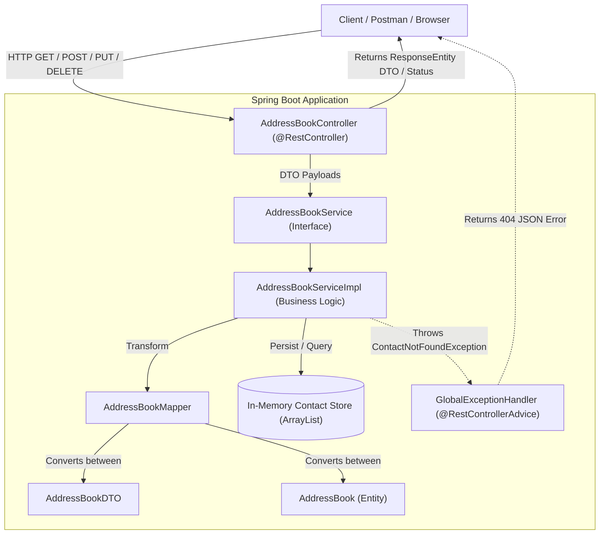
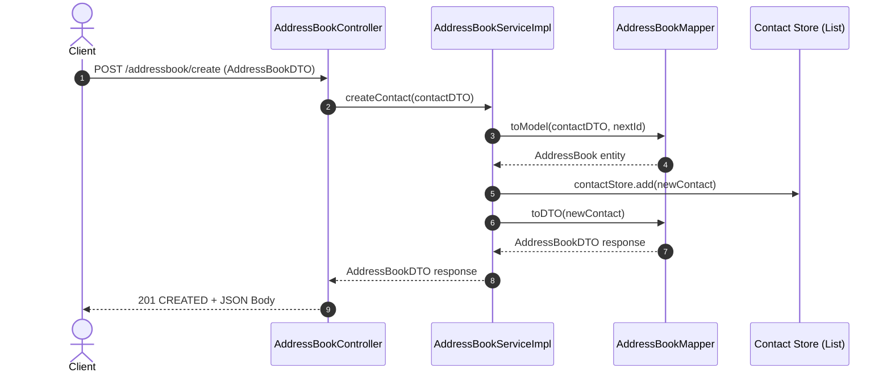

# Address Book Application – Spring Boot REST API

An enterprise-grade, modular backend REST API application developed using **Spring Boot**, **Java 21**, and **Maven**. This project demonstrates industry-standard backend design principles including layered architecture, separation of concerns, Data Transfer Objects (DTOs), entity mapping, service-layer business logic encapsulation, centralized global exception handling, and in-memory thread-safe state management.

---

## 📌 Project Overview

In personal and organizational workflows, managing contact information across disparate systems often leads to data duplication, inconsistencies, and communication breakdowns. The **Address Book Application** provides a robust, centralized RESTful API that enables client applications to seamlessly create, retrieve, update, and delete contact records.

The application adheres strictly to the **Separation of Concerns (SoC)** principle by dividing the codebase into clearly defined layers:
- **Presentation Layer (REST Controller):** Exposes HTTP endpoints, deserializes requests, validates inputs, and serializes JSON responses.
- **Service Layer:** Encapsulates core business workflows and data transformations.
- **Data Transfer Object (DTO) Layer:** Decouples internal data structures from external API contracts.
- **Model / Entity Layer:** Represents domain entities within the storage mechanism.
- **Exception Handling Layer:** Intercepts runtime anomalies globally and returns standardized, user-friendly error responses.

---

## 🎯 Problem Statement & Motivation

Traditional contact management approaches often face key challenges:
1. **Tight Coupling:** Direct coupling between database models and API payloads causes brittle APIs that break upon internal schema changes.
2. **Inconsistent Error Handling:** Unhandled exceptions can expose internal stack traces, leading to security vulnerabilities and poor client experiences.
3. **Monolithic Complexity:** Blending controller logic with persistence mechanisms makes unit testing and maintenance difficult.

This Address Book application resolves these issues by implementing clean architectural boundaries, standardized JSON response structures, and comprehensive unit and mock testing suites.

---

## 🚀 Key Features

* **Complete CRUD Operations:** Create, Read, Update, and Delete address book contacts.
* **RESTful Endpoint Design:** Clean, standardized URI paths conforming to HTTP method semantics (`GET`, `POST`, `PUT`, `DELETE`).
* **Layered Architecture:** Clear division across Controller, Service, DTO, Model, and Exception layers.
* **DTO & Entity Segregation:** Safe data exposure using `AddressBookDTO` and `AddressBookMapper`.
* **Centralized Exception Handling:** `@RestControllerAdvice` translates `ContactNotFoundException` into consistent `404 Not Found` JSON payloads.
* **In-Memory Store:** High-performance, fast development and testing without requiring immediate database provisioning.
* **Automated Unit & Integration Testing:** Comprehensive test coverage with **JUnit 5** and **Mockito**.

---

## 🛠️ Technology Stack

| Category | Technology / Library | Purpose |
| :--- | :--- | :--- |
| **Language** | Java 21 (LTS) | Modern object-oriented features, record compatibility, enhanced pattern matching |
| **Framework** | Spring Boot | Rapid production-ready application bootstrapping, embedded Tomcat server |
| **Web Layer** | Spring MVC | Annotation-driven REST API routing and JSON serialization |
| **Build & Dependency Tool** | Apache Maven | Project lifecycle management, compilation, and dependency resolution |
| **Testing Framework** | JUnit 5 (Jupiter) | Modern unit test execution and assertions |
| **Mocking Framework** | Mockito | Isolating service and controller components with test doubles |
| **Logging** | SLF4J with Logback | Production-grade structured application logging |
| **Version Control** | Git & GitHub | Distributed version control following GitFlow methodology |

---

## 🏗️ System Architecture

The following diagram illustrates the layered execution flow from an incoming HTTP client request down to the in-memory storage:



### Request-Response Sequence



---

## 📂 Project Structure

```text
AddressBook/
├── .gitattributes
├── .gitignore
├── mvnw
├── mvnw.cmd
├── pom.xml
├── README.md
├── .mvn/
│   └── wrapper/
│       └── maven-wrapper.properties
└── src/
    ├── main/
    │   ├── java/
    │   │   └── com/
    │   │       └── addressbook/
    │   │           ├── AddressBookApplication.java
    │   │           ├── controller/
    │   │           │   └── AddressBookController.java
    │   │           ├── dto/
    │   │           │   └── AddressBookDTO.java
    │   │           ├── exception/
    │   │           │   ├── ContactNotFoundException.java
    │   │           │   └── GlobalExceptionHandler.java
    │   │           ├── mapper/
    │   │           │   └── AddressBookMapper.java
    │   │           ├── model/
    │   │           │   └── AddressBook.java
    │   │           └── service/
    │   │               ├── AddressBookService.java
    │   │               └── AddressBookServiceImpl.java
    │   └── resources/
    │       └── application.properties
    └── test/
        └── java/
            └── com/
                └── addressbook/
                    ├── AddressbookApplicationTests.java
                    ├── controller/
                    │   └── AddressBookControllerTest.java
                    └── service/
                        └── AddressBookServiceImplTest.java
```

### Directory & Component Breakdown

* **`com.addressbook.AddressBookApplication`**: Main entry point initializing Spring Boot's context and embedded Tomcat server.
* **`com.addressbook.controller`**: Exposes REST endpoints (`/addressbook`) and translates requests into service calls.
* **`com.addressbook.service`**: Contains interface specifications and concrete implementations for contact business operations.
* **`com.addressbook.dto`**: Plain Java transfer objects preventing internal entity exposure.
* **`com.addressbook.mapper`**: Static conversion methods transferring fields between entities and DTOs.
* **`com.addressbook.model`**: Internal domain representation of an Address Book record (`id`, `firstName`, `lastName`, `phoneNumber`).
* **`com.addressbook.exception`**: Centralized exception handling intercepting errors and formatting standardized JSON error payloads.
* **`src/test/java`**: Comprehensive test suites verifying controller mocking, service isolation, and edge cases.

---

## 🔄 Iterative Use Cases (GitFlow Stages)

The repository was built following a structured, use-case driven GitFlow methodology:

| Use Case Branch | Objective | Key Deliverables |
| :--- | :--- | :--- |
| `feature/Section1-UC1-Setup` | Initial Spring Boot Setup | Configured Maven dependencies, properties, application class, and base health test |
| `feature/Section1-UC2-Rest-Controller` | Basic REST Endpoints | Implemented controller routes returning initial responses and controller tests |
| `feature/Section2-UC1-DTOModel` | DTO & Model Layer | Added `AddressBook` model, `AddressBookDTO`, and `AddressBookMapper` |
| `feature/Section2-UC2-Service-Layer` | Service Layer Architecture | Introduced `AddressBookService` interface, implementation, and Mockito controller tests |
| `feature/Section2-UC3-In-Memory-Storage` | In-Memory Persistence & Exceptions | Implemented in-memory `ArrayList` storage, `ContactNotFoundException`, and `GlobalExceptionHandler` |

---

## 📡 REST API Reference

All routes are relative to `http://localhost:8080/addressbook`.

### 1. Retrieve All Contacts
* **Method:** `GET`
* **Path:** `/` or `/addressbook`
* **Response Status:** `200 OK`
* **Response Body:**
```json
[
  {
    "id": 1,
    "firstName": "Ashish",
    "lastName": "Srivastava",
    "phoneNumber": "9876543210"
  }
]
```

---

### 2. Retrieve Contact by ID
* **Method:** `GET`
* **Path:** `/get/{id}`
* **Response Status:** `200 OK` (when found) / `404 Not Found` (when invalid)
* **Response Body (`200 OK`):**
```json
{
  "id": 1,
  "firstName": "Ashish",
  "lastName": "Srivastava",
  "phoneNumber": "9876543210"
}
```
* **Error Response Body (`404 Not Found`):**
```json
{
  "timestamp": "2026-11-13T17:36:06",
  "status": 404,
  "error": "Not Found",
  "message": "Contact not found with ID: 99"
}
```

---

### 3. Create a New Contact
* **Method:** `POST`
* **Path:** `/create`
* **Request Header:** `Content-Type: application/json`
* **Request Body:**
```json
{
  "firstName": "Ashish",
  "lastName": "Srivastava",
  "phoneNumber": "9876543210"
}
```
* **Response Status:** `201 CREATED`
* **Response Body:**
```json
{
  "id": 1,
  "firstName": "Ashish",
  "lastName": "Srivastava",
  "phoneNumber": "9876543210"
}
```

---

### 4. Update an Existing Contact
* **Method:** `PUT`
* **Path:** `/update/{id}`
* **Request Header:** `Content-Type: application/json`
* **Request Body:**
```json
{
  "firstName": "Ashish",
  "lastName": "Srivastava",
  "phoneNumber": "9999999999"
}
```
* **Response Status:** `200 OK`
* **Response Body:**
```json
{
  "id": 1,
  "firstName": "Ashish",
  "lastName": "Srivastava",
  "phoneNumber": "9999999999"
}
```

---

### 5. Delete a Contact
* **Method:** `DELETE`
* **Path:** `/delete/{id}`
* **Response Status:** `200 OK`
* **Response Body:**
```text
Contact deleted successfully with ID: 1
```

---

## ⚙️ Installation & Setup Guide

### Prerequisites
* **Java Development Kit (JDK):** Version 17 or higher (Java 21 LTS recommended).
* **Git:** Version 2.30+.
* **Maven:** Included via the provided Maven Wrapper (`./mvnw`).

### 1. Clone the Repository
```bash
git clone https://github.com/ashishsrivastava1712/AddressBook.git
cd AddressBook
```

### 2. Switch to Development Branch
```bash
git checkout develop
```

### 3. Build the Application
```bash
# On Linux / macOS
./mvnw clean install

# On Windows (PowerShell / Command Prompt)
.\mvnw.cmd clean install
```

### 4. Run the Application
```bash
# On Linux / macOS
./mvnw spring-boot:run

# On Windows
.\mvnw.cmd spring-boot:run
```
The server will start on port `8080`. You can verify by opening:
```text
http://localhost:8080/addressbook
```

---

## 🧪 Testing

The project includes unit and integration tests covering positive paths, edge cases, and exception handling.

### Run Tests
```bash
# On Windows
.\mvnw.cmd test

# On Linux / macOS
./mvnw test
```

### Test Coverage Highlights:
- **`AddressBookControllerTest`**: Validates HTTP status codes, JSON serialization, and verifies mock interactions using Mockito.
- **`AddressBookServiceImplTest`**: Asserts in-memory state preservation, unique ID increments, updates, deletions, and verifies `ContactNotFoundException` on missing IDs.
- **`AddressbookApplicationTests`**: Spring context load verification.

---

## 🔮 Future Enhancements

1. **Persistent Database Layer:** Integrate Spring Data JPA / Hibernate with MySQL or PostgreSQL.
2. **Input Validation:** Add Jakarta Bean Validation (`@Valid`, `@NotBlank`, `@Pattern` for phone numbers and email validation).
3. **Security Integration:** Implement Spring Security with JWT (JSON Web Tokens) for role-based access control (RBAC).
4. **API Documentation:** Integrate Springdoc OpenAPI 3 (Swagger UI) for interactive API documentation at `/swagger-ui.html`.
5. **Pagination & Sorting:** Support `Pageable` queries on `GET /addressbook` for large datasets.

---

## 👤 Author

**Ashish Srivastava**  
* GitHub: [@ashishsrivastava1712](https://github.com/ashishsrivastava1712)  
* Email: isroasaws@gmail.com  
* Repository: [https://github.com/ashishsrivastava1712/AddressBook](https://github.com/ashishsrivastava1712/AddressBook)
